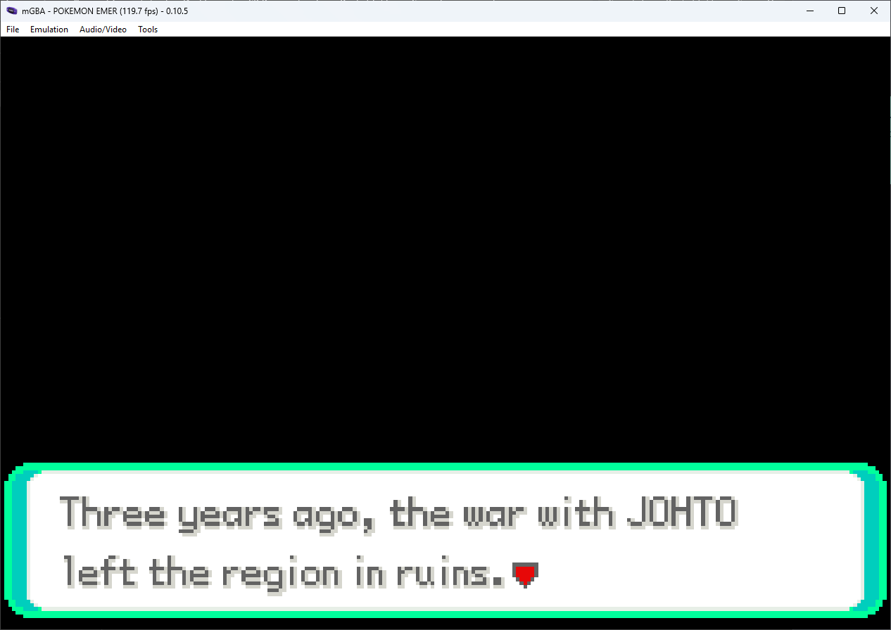
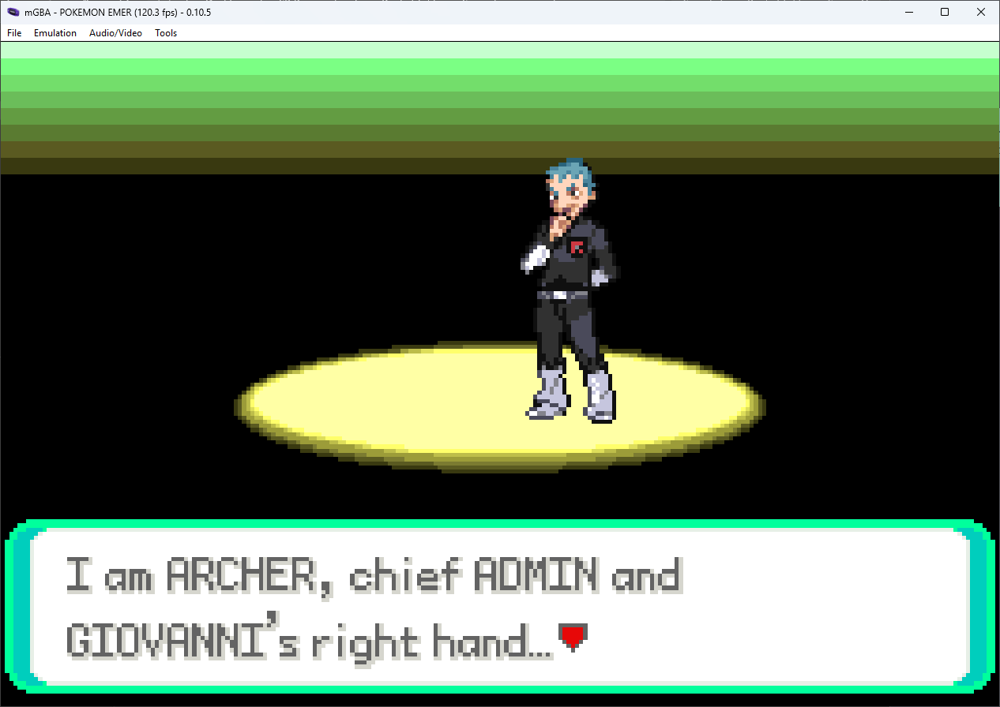
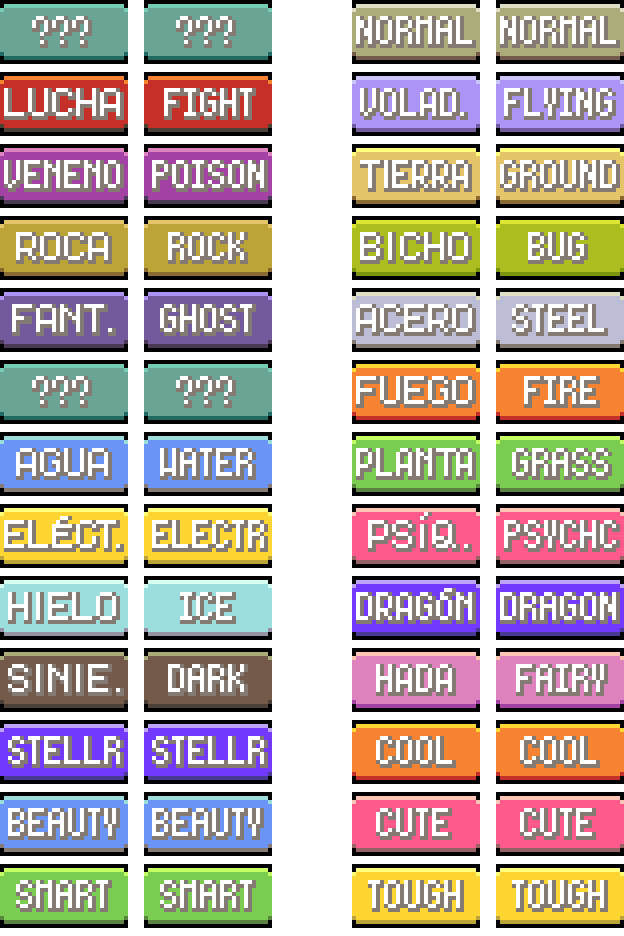
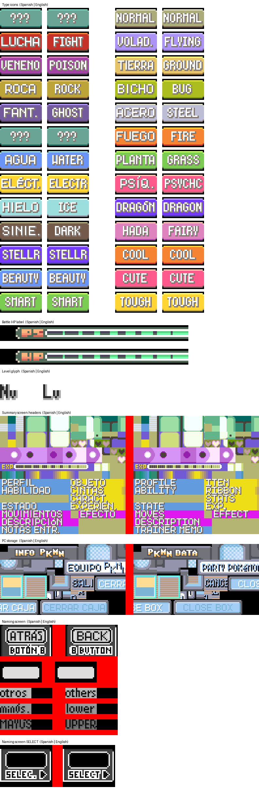
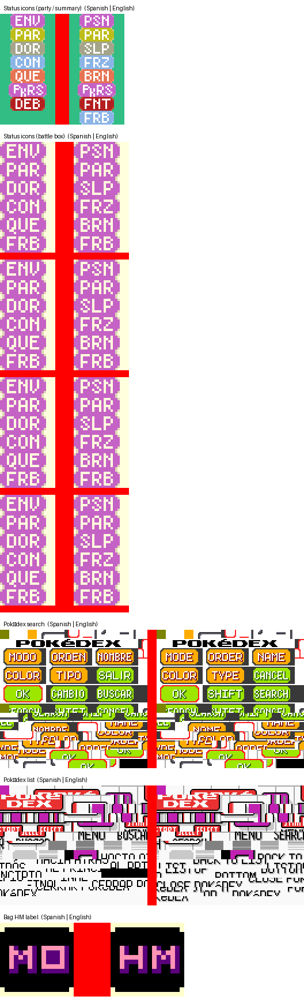
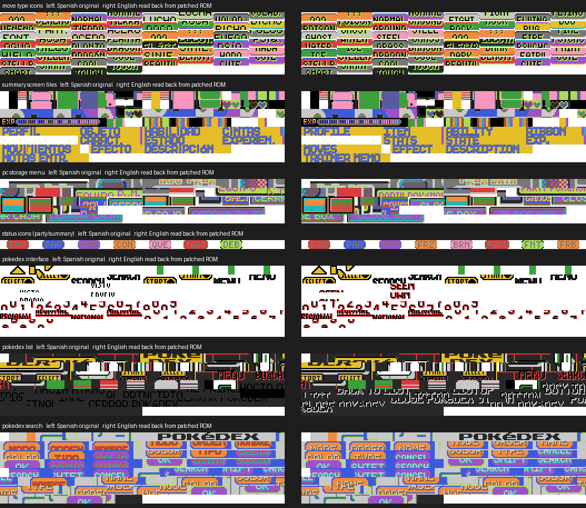

<div align="center">

# Pokémon Team Rocket Edition v3.0.6 — English Translation

**An unofficial fan translation of the Spanish GBA romhack *Pokémon Team Rocket Edition* into natural English.**


-yellow)
-blue)


 

</div>

> [!IMPORTANT]
> **The official translation is coming.** The Team Rocket Edition developers have said their own English translation of **v3.1.0** is close to completion and expected within 1–2 months (as of 23 Nov 2026).
> This project is **not affiliated with or endorsed by** the developers. When the official v3.1.0 English release is out, please play and support that version. This repo will then stay up only as an archive of the v3.0.6 translation.

---

## Contents

- [About](#about)
- [Status](#status)
- [How to play](#how-to-play)
- [Screenshots](#screenshots)
- [Known issues](#known-issues)
- [Reporting problems](#reporting-problems)
- [Repository layout](#repository-layout)
- [Credits & legal](#credits--legal)

## About

*Team Rocket Edition* puts you in a Team Rocket uniform, working your way up the ranks under GIOVANNI across Kanto, the Sevii Islands, Johto, the Johto DLC and Hoenn, with the Hoenn story taking you as far as Snowpoint City in Sinnoh. Version 3.0.6 is only available in Spanish. The last official English release, v1.5, covers Kanto, the Sevii Islands and Johto only.

This patch translates the whole of v3.0.6. The aim is English that reads like an official Pokémon game rather than a word-for-word translation: official English names for characters, places, moves and items, US spelling, and dialogue rewritten to sound natural while keeping the original meaning and tone. Only the text and text graphics are changed. Gameplay, maps and story are exactly as the original team made them.

## Status

| Area | Status |
|---|---|
| Story and map dialogue (Kanto, Sevii, Johto, Johto DLC, Hoenn, Snowpoint City) | ✅ Translated |
| Battle messages and trainer quotes | ✅ Translated |
| Menus, bag, PC, summary screen, options, Battle Frontier, Rocket Timeline | ✅ Translated |
| Items, berries, key items, Mega Stones | ✅ Translated |
| Moves, abilities, natures, location names | ✅ Translated |
| Trainer classes and Pokédex categories | ✅ Translated |
| Pokédex entries | ✅ Translated |
| Text graphics (type icons, HP/Lv, party screen, summary headers, PC, naming screen, Pokédex UI, trainer card) | 🟡 Done, awaiting in-game test |
| Consistency and line-width passes | ✅ Done |
| Full playthrough test | ⏳ In progress |

About **26,300 strings** are translated. See [CHANGELOG.md](CHANGELOG.md) for what changed in each build.

## How to play

1. **Get your own copy** of the Spanish *Team Rocket Edition v3.0.6* ROM. No ROMs are provided here and none will be shared.
2. **Check it's the right file.** The patch only works on this exact ROM:

   | | |
   |---|---|
   | MD5 | `911e690484204ac1621211560aba356d` |

3. **Download the patch:** [`patch/TRE_v3.0.6_English.bps`](patch/TRE_v3.0.6_English.bps)
4. **Apply it** with [ROM Patcher JS](https://www.marcrobledo.com/RomPatcher.js/) (in your browser) or [Floating IPS](https://www.romhacking.net/utilities/1040/).
5. **Play** in [mGBA](https://mgba.io/) or another accurate GBA emulator.

> [!TIP]
> If you're updating to a newer patch with ROM Patcher JS, **refresh the page first**. The site can hold on to the previous patch file, which leaves old (or Spanish) text in the game.
>
> Always patch the **original Spanish ROM**, never a ROM that was already patched.

**Saves:** saves from the Spanish version should carry over, since only text and graphics change. If something looks wrong, test on a fresh save before reporting it.

## Screenshots

| Type icons, before and after | Interface graphics |
|---|---|
|  |  |

<details>
<summary>More graphics previews</summary>



Every repacked graphic, read back from the patched ROM (left: Spanish original, right: English):



</details>

## Known issues

- **Graphics not yet tested in-game.** The translated text graphics are in the patch and read back correctly from the patched ROM, but they haven't had a full playtest yet. If a menu or icon looks garbled, please report it.
- **Two "Baya" labels** (Spanish for "Berry") only have room for 4 letters and are still in Spanish.
- **Some hack-original graphics** that aren't part of the base engine may still show Spanish.
- **Possible missed lines.** Some strings are stored in unusual ways and can slip past the extractor. Anything left in Spanish is a bug — please report it.

## Reporting problems

Use the [issue tracker](../../issues/new/choose). The quickest reports to fix include:

- a **screenshot**
- **where** you were (map or menu) and what you were doing
- the **patch version** you used

There are templates for untranslated text, translation errors and glitches.

## Repository layout

```
patch/            The BPS patch. This is all you need to play.
translations/     The English script: one "ROM-offset|English" line per string
graphics/data/    Translated graphics and the patch list that places them
tools/            Python tools: text codec, build, checks, graphics helpers
docs/
  GLOSSARY.md     Naming conventions (official names, hack-specific terms)
  HOW_IT_WORKS.md Technical notes on the text and graphics pipeline
  images/         Screenshots and previews
  dev/            Working notes and the translator brief
CHANGELOG.md      Release history
```

The Spanish source script belongs to the original team and isn't published here. The tools need your own ROM and a locally generated string index to rebuild the patch. See [docs/HOW_IT_WORKS.md](docs/HOW_IT_WORKS.md).

## Credits & legal

- ***Pokémon Team Rocket Edition*** was created by its original Spanish development team. All credit for the game, story and design goes to them. This project only translates their text.
- **English translation:** [LukeU123](https://github.com/LukeU123), with Claude (Anthropic).
- Graphics are based on the English assets from [pokeemerald-expansion](https://github.com/rh-hideout/pokeemerald-expansion), the engine the hack is built on.
- *Pokémon* is © Nintendo, Game Freak and The Pokémon Company. This is a free, non-commercial fan project. It contains no ROM data and must not be sold.
- The tools in `tools/` are under the [MIT License](LICENSE). The translation text is shared for personal, non-commercial use.
